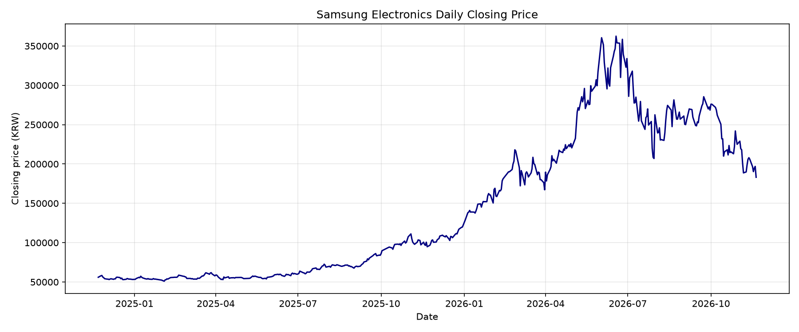
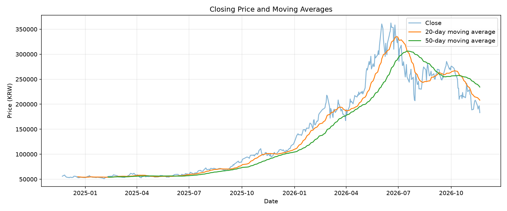
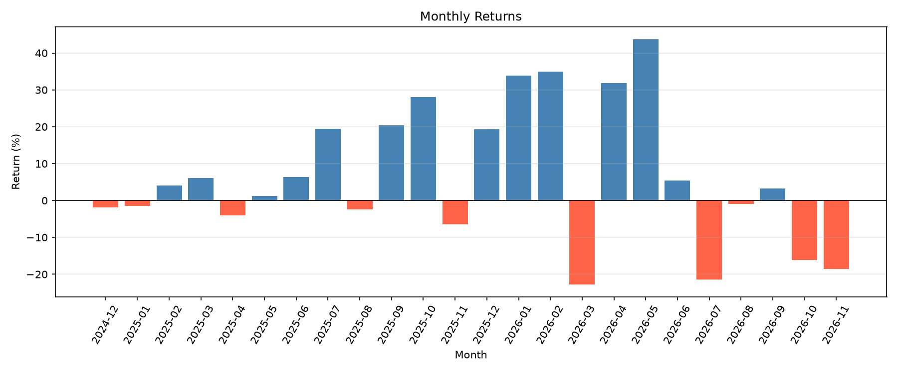

# 삼성전자 일별 주가 시계열 분석 리포트

## 1. 분석 주제 및 선정 이유

이 보고서는 삼성전자 보통주(종목 코드 `005930.KS`)의 일별 주가를 분석한다. 주가 데이터는 시간에 따라 값이 변하는 대표적인 시계열 데이터다. 전체 가격 추이뿐 아니라 이동평균과 월별 수익률을 함께 살펴보며, 장기 추세와 단기 변동이 어떻게 다른지 확인하고자 했다.

## 2. 분석 질문

1. 분석 기간 동안 삼성전자 종가는 어떤 전체 추세를 보였는가?
2. 종가와 20일·50일 이동평균을 비교했을 때 추세가 약해지거나 전환된 구간은 어디인가?
3. 월별 수익률의 차이는 어느 정도이며, 가장 높은 달과 낮은 달은 언제인가?
4. 분석 기간 중 가장 큰 일일 상승·하락은 언제 발생했으며, 이를 데이터 오류와 실제 시장 변동 중 무엇으로 볼 근거가 있는가?

## 3. 데이터 설명 및 정제

- **종목:** 삼성전자 보통주 (`005930.KS`)
- **출처:** Yahoo Finance
- **수집 방법:** Python `yfinance` 라이브러리로 일별 데이터를 수집해 `data/samsung_stock.csv`에 저장
- **분석 기간:** 그래프상 2024년 말부터 2026년 11월까지. 정확한 시작일·종료일은 CSV의 `Date` 최솟값·최댓값 기준으로 확인
- **데이터 수:** `[실행 결과에 표시된 분석 데이터 수 입력]`개
- **주요 컬럼:** Date, Open, High, Low, Close, Adj Close, Volume
- **결측치·중복 처리:** 날짜순 정렬 후 중복 날짜를 제거하고, 종가(`Close`)가 결측인 행은 분석에서 제외했다. 결측값을 임의로 보간하지 않았다.
- **이상치 처리:** 극단적인 수익률도 실제 시장 변동일 가능성이 있어 일괄 삭제하지 않았다. 특히 큰 변동일은 별도 자료와 대조했다.

> 제출 전 `main.py` 실행 결과에서 분석 데이터 수와 날짜 범위를 확인해 위 항목을 채운다. 결측치 수 출력도 확인해 실제 결과에 맞게 정제 설명을 보완한다.

## 4. 분석 방법

1. **종가 추이:** 시간순 종가를 선 그래프로 표시해 전체 추세와 급격한 변화 구간을 확인했다.
2. **이동평균:** 20거래일 이동평균과 50거래일 이동평균을 계산했다. 이동평균은 일별 가격의 잡음을 완화해 단기·중기 흐름을 비교하는 데 사용했다.
3. **일별 수익률:** 전일 대비 종가 변화율을 백분율로 계산했다.
4. **월별 수익률:** 각 월의 마지막 거래일 종가를 기준으로 전월 말 대비 수익률을 계산했다.

## 5. 분석 결과 및 시각화

### 5.1 종가 추이



그래프에서 종가는 2025년 초 낮은 수준에서 출발해 2026년 상반기까지 크게 상승했다. 2026년 6월 고점 이후에는 등락과 하락이 이어졌고, 그래프 끝부분의 종가는 고점보다 낮다.

### 5.2 종가와 이동평균



상승 구간에서는 종가와 이동평균이 함께 위로 움직였다. 고점 이후에는 종가가 이동평균 아래로 내려가는 구간이 나타난다. 그래프 끝부분에서는 종가가 20일·50일 이동평균선 아래에 있고, 20일 이동평균선도 50일선보다 낮아 보인다. 이는 분석 기간 마지막 구간의 단기 흐름이 약해졌다는 관찰 근거다.

### 5.3 월별 수익률



월별 수익률은 양수와 음수 구간이 섞여 있으며 월별 차이가 크다. 2026년 5월에는 큰 폭의 상승, 2026년 3월에는 큰 폭의 하락이 확인된다. 그래프의 마지막 달은 분석 종료일까지의 부분 기간일 수 있으므로 완전한 한 달과 직접 비교할 때 주의가 필요하다.

## 6. 핵심 인사이트

### 인사이트 1 — 큰 폭의 장기 상승과 고점 이후 조정이 함께 나타났다

- **관찰(Fact):** 최저 종가는 2025-02-03의 51,000원, 최고 종가는 2026-06-18의 362,500원이다. 두 값을 비교하면 최저 종가에서 최고 종가까지 약 **610.8% 상승**했다. 다만 종가 그래프에서는 2026년 6월 고점 뒤 하락 흐름도 확인된다.
- **해석(Hypothesis):** 전체 기간의 시작과 끝만 비교하면 상승을 강조하게 되지만, 고점 이후의 조정도 중요한 패턴이다. 따라서 이 기간을 일방적인 상승 추세로만 요약하면 변동 위험을 놓칠 수 있다.
- **다음 분석(Action):** 고점 대비 하락률과 구간별 수익률을 계산해 상승 구간과 조정 구간의 크기를 따로 비교한다.

### 인사이트 2 — 2026년 7월 말에 기록적인 일일 반등이 있었다

- **관찰(Fact):** 가장 큰 일간 하락은 2026-07-28의 **-13.39%**, 가장 큰 일간 상승은 2026-07-31의 **+26.81%**였다.
- **해석(Hypothesis):** 해당 상승률은 단순한 계산 오류라고 단정할 수 없다. 연합뉴스는 2026년 7월 31일 삼성전자가 26.81% 상승해 262,500원으로 마감했다고 보도했다. 보도는 앞선 급락 이후의 반등과 반도체 투자심리 회복 등을 다뤘다. 외부 보도와 수치가 일치하므로, 이 값은 실제 시장 변동으로 해석할 근거가 있다. 다만 주가 변동의 원인을 이 보고서만으로 확정하지 않는다.
- **다음 분석(Action):** 코스피 지수 및 반도체 업종 지수와 같은 날짜의 수익률을 비교해 개별 종목 요인과 시장 요인을 분리한다.

### 인사이트 3 — 월별 성과의 편차가 컸다

- **관찰(Fact):** 월별 수익률 최고는 2026년 5월 **+43.76%**, 최저는 2026년 3월 **-22.77%**였다.
- **해석(Hypothesis):** 큰 상승월과 하락월이 함께 있다는 점은 월별 성과가 균일하지 않았음을 보여준다. 단순한 평균 수익률만으로 투자 위험이나 흐름의 안정성을 설명하기 어렵다.
- **다음 분석(Action):** 월별 표준편차 또는 변동성을 함께 계산하고, 마지막 미완료 월은 완전한 월과 구분해 비교한다.

## 7. 결론

분석 기간 동안 삼성전자 종가는 2026년 6월까지 큰 폭으로 상승한 뒤 고점에서 조정받는 흐름을 보였다. 이동평균 그래프에서도 마지막 구간의 종가가 이동평균선 아래에 위치해 단기 흐름이 약해진 모습을 확인할 수 있다. 월별 수익률과 일별 변동 사례는 전체 상승률만으로는 기간 중 위험과 급격한 변화를 충분히 설명할 수 없음을 보여준다.

따라서 시계열 데이터를 해석할 때는 전체 추세뿐 아니라 이동평균, 월별 수익률, 급등·급락 구간을 함께 살펴야 한다. 이번 분석은 과거 데이터의 패턴을 요약한 것이며 미래 주가를 예측하거나 투자 판단을 권고하지 않는다.

## 8. 한계점

- 주가만 분석했으며 거래량, 코스피, 환율, 금리, 기업 실적 등 다른 변수를 함께 분석하지 않았다.
- 관찰된 가격 변화와 외부 사건 사이의 인과관계를 검증하지 않았다. 외부 보도는 급등일의 시장 맥락을 확인하는 보조 자료로만 사용했다.
- 월별 수익률은 월말 종가를 기준으로 했으며, 마지막 달은 데이터 수집 시점에 따라 미완료 월일 수 있다.
- 이동평균은 과거 가격을 요약하는 지표이므로 미래 가격을 보장하지 않는다.
- Yahoo Finance 데이터는 제공처의 갱신·조정 방식에 영향을 받을 수 있다. 재현 시 수집 날짜와 원본 CSV를 함께 보관해야 한다.

## 9. 실행 방법 및 재현성

프로젝트 폴더에서 가상환경을 활성화한 뒤 다음 명령으로 필요한 라이브러리를 설치하고 스크립트를 실행한다.

```bash
python -m pip install yfinance pandas matplotlib
python main.py
```

`main.py`는 원자료를 `data/samsung_stock.csv`에 저장하고 그래프를 `images/` 폴더에 출력한다. 리포트의 이미지 링크가 동작하려면 `REPORT.md`와 `images/` 폴더를 같은 프로젝트 폴더에 둔다.

## 10. AI 사용 로그

- **사용 작업:** 분석 질문 구성, 시계열 분석 코드 작성 보조, 그래프에서 확인한 결과를 관찰·해석·추가 분석으로 정리, 리포트 문장 구성
- **사용 이유:** 분석 절차와 보고서 구조를 체계화하고, 코드·해석 초안을 효율적으로 마련하기 위해 사용
- **검증 방법:** 코드를 사용자가 직접 실행해 CSV와 그래프를 생성하고, 출력된 최고·최저 종가 및 수익률을 확인했다. 2026-07-31의 +26.81% 상승률은 연합뉴스 보도와 대조했다. 원인 해석은 확정 사실이 아니라 가설로 구분했다.

## 참고 자료

- [Yahoo Finance — 삼성전자 과거 데이터](https://finance.yahoo.com/quote/005930.KS/history/)
- [연합뉴스 — 코스피, 17.9%·1000p 폭등하며 '불기둥'…사상최대 상승(종합), 2026-07-31](https://www.yna.co.kr/view/AKR20260731119651008)
